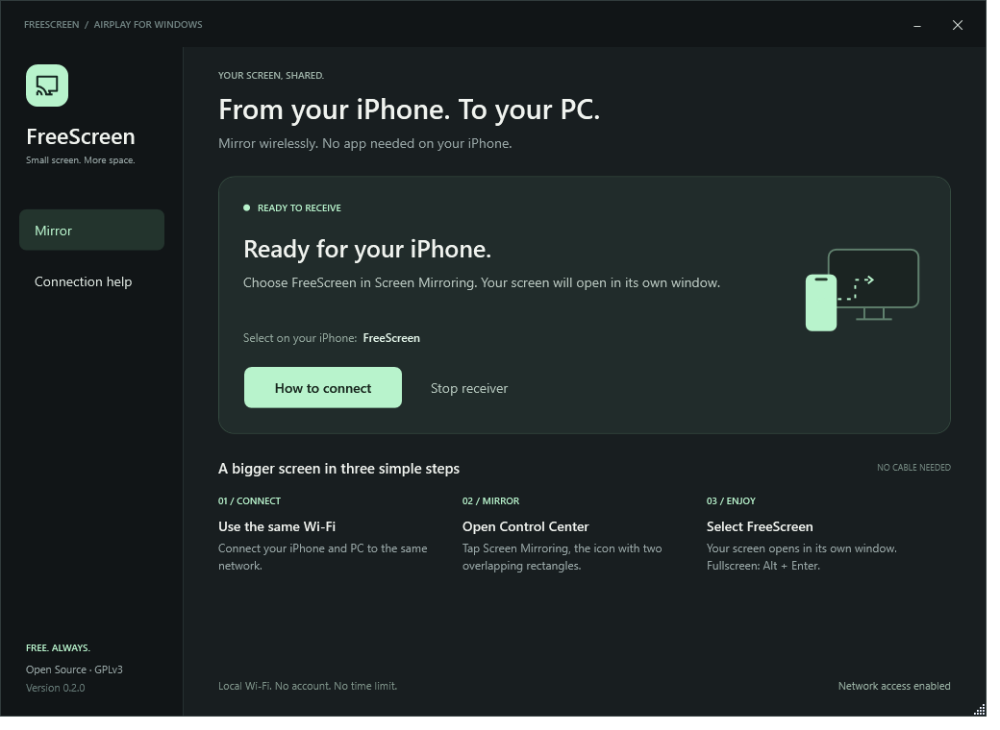

<p align="center"></p>
<p align="center"><strong>A free, local AirPlay receiver for Windows.</strong><br>No account. No subscription. No app on your iPhone.</p>



FreeScreen mirrors your iPhone to Windows over your local network. A native WPF interface handles connection status and troubleshooting; [UxPlay](https://github.com/FDH2/UxPlay) receives video and audio. The UI is in English.

## Features

- Wireless screen mirroring and audio through iOS Screen Mirroring.
- Clear waiting, device-connected, screen-connected, paused and error states.
- **Open screen window** brings the separate video window to the front.
- Local-network firewall setup and practical connection help.
- Keyboard focus indicators, a resizable window and original branding.
- No telemetry, accounts, subscriptions or time limits added by FreeScreen.

## Connect

1. Open the desktop shortcut or `Start.vbs`.
2. Connect PC and iPhone to the same local network.
3. iPhone Control Center → **Screen Mirroring** (two overlapping rectangles) → **FreeScreen**.
4. The picture opens in a **separate video window**. Press **Alt + Enter** there for fullscreen.

The media-output AirPlay picker can send audio without the screen. Closing FreeScreen stops its receiver; minimizing keeps it running.

If the receiver is missing, open **Connection help → Allow network access**. Windows asks for administrator permission. Rules allow local-subnet traffic to this receiver on TCP 7000–7002 and UDP 7000–7002/5353. Guest-network isolation and VPN settings can prevent discovery.

## Build from source

Requirements: Windows 10/11 x64, Git, Windows PowerShell 5.1, the Windows .NET Framework C# compiler, internet access and roughly 3 GB for the toolchain. Tested on Windows 11; no native ARM64 package is included.

This is a **source distribution**, without a prebuilt receiver or installer.

```powershell
powershell -NoProfile -ExecutionPolicy Bypass -File .\Prepare-Build.ps1
powershell -NoProfile -ExecutionPolicy Bypass -File .\Build-Native.ps1
powershell -NoProfile -ExecutionPolicy Bypass -File .\Setup.ps1
```

Then open `Start.vbs`. Bootstrap creates a local MSYS2 toolchain inside `vendor`, verifies the pinned archive hash, checks out the pinned UxPlay revision and applies the patch. Dependency versions are rolling, so builds are not bit-for-bit reproducible. No global PATH or autostart changes are made.

For later engine rebuilds, close FreeScreen and copy the contents of `native-staging` into `runtime`. Setup preserves an existing native runtime.

## Development

| File | Purpose |
| --- | --- |
| `ui/MainWindow.xaml` | Native layout, styles and keyboard-accessible controls |
| `FreeScreen.ps1` | State, navigation, lifecycle and video-window action |
| `ReceiverHost.cs` | Hidden process and local logs |
| `receiver.args` | 1080p, up to 60 FPS, software H.264 decoding |
| `Firewall.ps1` | App-scoped, local-subnet firewall rules |
| `Prepare-Build.ps1` / `Build-Native.ps1` | Pinned engine source and dependencies |
| `patches/combined-setup-info.patch` | Combined control SETUP receiver-info support |
| `Test-UI.ps1` / `test_receiver.py` | UI smoke checks and RTSP capability tests |
| `assets` | Original logo, icon and wordmark |

```powershell
# Offline UI checks and minimum-width screenshots
.\Test-UI.ps1
# Synthetic screenshot; leaves the receiver untouched
powershell -STA -File .\FreeScreen.ps1 -Preview -PreviewState ready -PreviewOutput "$PWD\docs\app.png"
# Requires an isolated receiver listening at 7201, without an iPhone
.\vendor\msys64\ucrt64\bin\python.exe .\test_receiver.py 7201
# Allowlisted public source ZIP
.\Export-Source.ps1
```

Screenshots use preview mode: no phone screen or device details are included. GitHub Actions checks the UI, not real iPhone mirroring. End-to-end testing requires a physical sender.

## Compatibility and privacy

Compatibility depends on the iOS release. Protected streaming content may remain black. Frame rate and latency depend on the network and devices.

The patch returns complete receiver information for `combinedGetInfoWithControlSetup`. It is a local compatibility change, not an upstream guarantee. Protocol tests cover its response and display capabilities; real mirroring has been exercised on the development PC.

Local-network devices may connect by default. UxPlay access-control options can be configured in `receiver.args`. Local logs can contain device names and network addresses; review them before sharing. Logs, binaries, toolchains and runtime state are ignored by Git.

## Credits and license

FreeScreen's launcher, UI and original branding: **GPL-3.0-or-later**, see [LICENSE](LICENSE). Receiver: [UxPlay](https://github.com/FDH2/UxPlay), retaining upstream authorship and component notices. See [THIRD_PARTY.md](THIRD_PARTY.md).

Independent community project, not affiliated with Apple or LonelyScreen. AirPlay is a trademark of Apple Inc.
